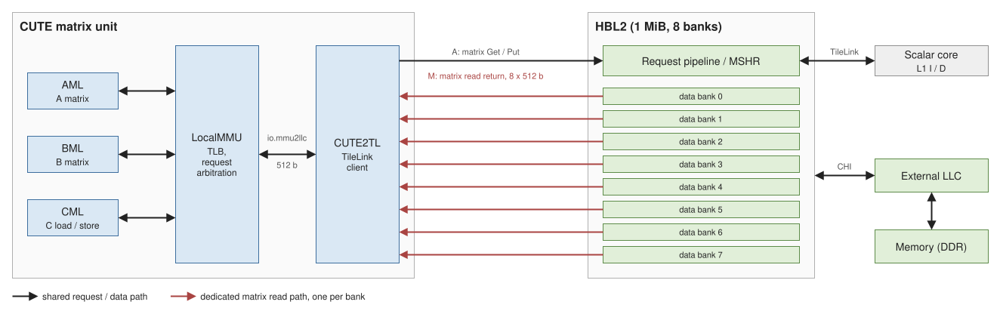

# 内存子系统与 HBL2 {#sec:xsai-memory}

本章描述香炉峰（XSAI）相对昆明湖 V2R2 新增的高带宽 L2（HBL2）与矩阵访存通路；通用内存模型见基线手册。

## HBL2 定位与动机

HBL2 基于昆明湖 `CoupledL2` 升级改造并兼容原有全部功能，对通用计算的影响很小。改造动因是大模型推理的访存带宽需求；原生 `CoupledL2` 存在三类结构性问题：

1. 缓存微架构产生的结构性阻塞；
2. 维护缓存一致性带来的冗余开销；
3. 传统替换 / 预取算法在大模型场景下失效。

## 带宽与容量

矩阵访存走一条独立的读通路，峰值读带宽 **512 B/cycle**，按 2.5 GHz 计约 1.25 TB/s。这是命中场景下的数字：替换与预取尚未改进，未命中时的实际带宽低于此值。

两套矩阵配置的 L2 容量都是 2 MiB。

## 矩阵访存接口

HBL2 为矩阵访存新增了三类标志位与一条返回通路：

* 请求侧标志位：`MatrixKey`、`AmeChannelKey`、`AmeIndexKey`，并在 L2 内部添加对应的矩阵请求标志；
* 返回侧接口：`matrixDataOut`，用于矩阵读数据返回。

两类矩阵请求的处理方式：

| 请求 | 处理方式 |
| --- | --- |
| 矩阵 Get | 处理方式类似 Acquire；miss 时向下 Acquire 获取 B 权限 |
| 矩阵 Put | 采用经典一致性方案：hit 则直接写入；miss 则进入 MSHR，向下 Acquire 获取 T 权限 |

矩阵数据当前按一致性方案处理。

## 矩阵访存通路

矩阵访存由三条搬运通路驱动，全部经 `LocalMMU` 与 `CUTE2TL` 接入存储层次：

| 通路 | 职责 |
| --- | --- |
| AML（AMemoryLoader） | A 矩阵搬运 |
| BML（BMemoryLoader） | B 矩阵搬运 |
| CML（CMemoryLoader） | C 矩阵 load 与 store |



`LocalMMU` 是对外暴露的唯一数据面接口，统一访问 LLC 与内存层次。矩阵单元顶层只暴露两个接口：`io.ctrl2top`（控制面，连到 `TaskController`）与 `io.mmu2llc`（数据面，连到 `LocalMMU`）。

### 关键参数

| 参数 | 定义 | 约束 |
| --- | --- | --- |
| `outsideDataWidth` | LocalMMU 数据返回位宽 | 2 的幂，常见配置 512 bit |
| `outsideDataWidthByte` | `outsideDataWidth / 8` | 必须小于等于 `Tensor_K` |
| `ABMatrixRegNBanks` | AB MatrixReg bank 数 | 等于 `Matrix_MN` |
| `ABMatrixRegEntryByteSize` | 单 bank entry 宽度 | `OOORouter` 要求 32 B |
| `Trans_Load_Size` | `outsideDataWidthByte / ABMatrixRegNBanks`，也是三角流水 lane 数 | 只支持 8 或 16，且必须为 2 的幂 |
| `ReduceGroupSize` | `Tensor_K / ReduceWidthByte` | 参数层要求为 2 |
| `MMUAddrWidth` | memory 请求地址宽度 | 默认 64 |

### 两条子通路

| 子模块 | 职责 |
| --- | --- |
| `TransAlignPipe` | 非均匀对齐流水线，处理转置路径的对齐；每个 bank 一套 |
| `OOORouter` | 乱序路由器与写入规约树；单 bank entry 要求 32 B |

转置路径绕过非转置路径的 fill table（深度由 `AMemoryLoaderReadFromMemoryFIFODepth` 决定）。

## 操作数池

### 池位置在运行期解析，不是固定地址

矩阵操作数缓冲必须位于**物理连续内存池**，但池基址**不是硬编码的 `0x100000000`**。`xsai_alloc.c` 按以下顺序解析，**先命中者胜**：

| 顺序 | 来源 | 变量 / 路径 |
| ---: | --- | --- |
| 1 | 环境变量 | `XSAI_AME_RESERVED_BASE` / `XSAI_AME_RESERVED_SIZE`（十六进制或十进制） |
| 2 | 设备树 | `/proc/device-tree/reserved-memory/direct_map@<addr>/reg` |
| 3 | 编译期默认值 | `RESERVED_PHYS_BASE_ADDR`（旧路径，**命中会大声打日志**） |
| 4 | 都不命中 | 硬失败，附可操作的报错信息 |

### 两套标准内存布局

| 镜像 | 总内存 | 池大小 | 池基址 |
| --- | --- | --- | --- |
| appliance | 8 GB | 6 GB | `0x1_0000_0000` |
| ruyi / mega | 16 GB | 4 GB | `0x3_8000_0000` |

**为什么不用纯编译期常量**：同一个二进制必须同时适配这两套布局。若把基址钉死在错误的那一套上，**普通内核内存会被映射成 AMU 池，第一条 AME store 就会 fault**——表现为 OpenSBI trap、机器死锁（该现象有复现记录）。

CMake 默认沿用的是 appliance 布局（基址 `0x100000000`，池 **6 GiB**，与 `mk/memory.mk` 的 `XSAI_DIRECT_MAP_MEM_SIZE` 默认值及 DTB 的 `direct_map` 节点一致）。要构建 mega 版本需显式传入：

```bash
cmake ... -DXSAI_RESERVED_PHYS_BASE_ADDR=0x380000000ULL \
          -DXSAI_RESERVED_MEMORY_SIZE='(4096L*1024L*1024L)'
```

### 分配模式

分配模式必须由外部环境决定，**不能编进产物**（否则同一二进制换环境即失效）：

| 变量 | 取值 | 含义 |
| --- | --- | --- |
| `XSAI_ALLOC_MODE` | `malloc` | 用对齐 malloc/free，不使用池 |
| | `anon` | 即使定义了 `RESERVED_PHYS_BASE_ADDR` 也用匿名 mmap 池（仅宿主机测试） |
| `XSAI_ALLOC_POOL_SIZE_MB` | 数值 | 匿名池的尺寸覆盖（宿主机测试用） |

匿名模式只用于 QEMU 用户态或宿主机测试。若被无条件带上板，表现为 `SIGABRT`（`rc=134`），或匿名池下算错、被进程内的条件检查拦下（`rc=255`）。

### 地址翻译的依赖关系

只有池**确实**由物理连续内存支撑时（huge pages 或 `RESERVED_PHYS_BASE_ADDR`），AMU 才能使用「单一 TLB 基址 + 物理偏移」寻址：

```text
PA = TLB(pool_base) + (ptr - pool_base)
```

这正是「**不逐行重查 TLB**」的实现基础，也是下面这条约束的由来：行地址按 `PA_base + row × stride` 计算，因此非连续缓冲在行数较大时（如 63 行、127 行以上）会**静默读错**，而不是报错。

## 可见性与内存序

* 矩阵访存与其他访存之间的顺序约束由同步指令与 CSR 语义给出；
* 矩阵结果对向量 / 标量的可见性用 `macquire`，非矩阵访存对矩阵引擎的可见性用 `mfence`（两者方向不同）；
* `mrelease` / `macquire` 必须覆盖所有退出分支，否则会出现偶发错（非稳定复现）；
* 缺少同步时的行为未定义。

