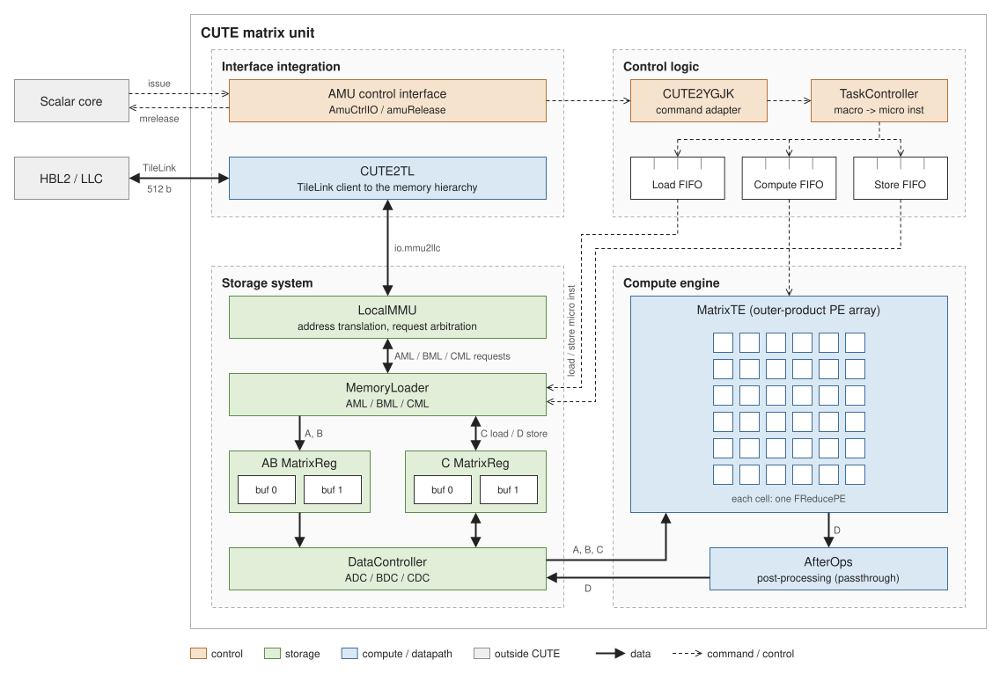
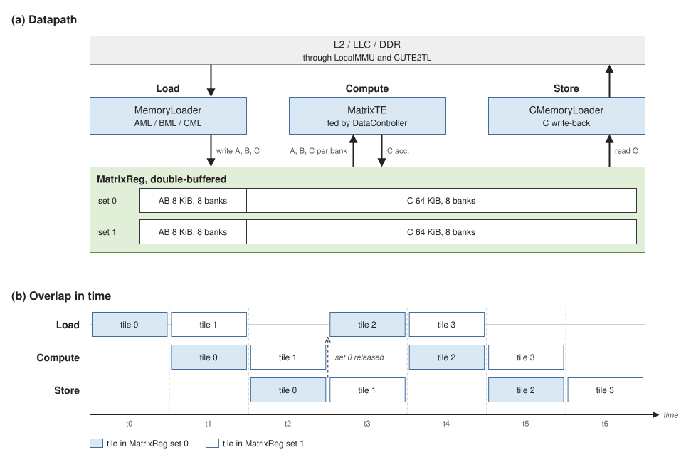

# 微架构增量 {#sec:xsai-microarchitecture}

香炉峰在昆明湖 V2R2 的基础上增加了一个矩阵协处理器。标量核、流水线宽度、分支预测、存储层次等基线结构没有改动，本章只讲新增的这部分。

## 矩阵计算单元（CUTE）

CUTE 附挂在标量核旁边。标量核执行 ZAMES / ZMASYNC 指令，通过核内控制接口把任务下发给 CUTE；计算完成后，CUTE 通过同步寄存器通知标量侧。这里没有走 RoCC，用的是核内矩阵控制接口。

CUTE 内部按四个子系统组织：

| 子系统 | 主要组成 | 职责 |
| --- | --- | --- |
| 控制 | TaskController | 接收指令、分解任务、调度执行 |
| 存储 | AB / C MatrixReg、MemoryLoader、LocalMMU | 数据搬运、缓冲与地址翻译 |
| 计算 | MatrixTE、FReducePE、AfterOps | 矩阵乘加与后处理 |
| 接口 | 核内 AMU 控制接口、TileLink 总线接口 | 与标量核和系统总线对接 |

## 计算流水

CUTE 按 Load → Compute → Store 三段组织，配备两套 MatrixReg 交替使用：一个 tile 在计算时，下一个 tile 的数据已经在并行加载。

* **Load**：MemoryLoader 经 LocalMMU 从 L2 / LLC / DDR 取数，写入 AB / C MatrixReg；
* **Compute**：MatrixTE 是 PE 阵列的外积数据流，支持背压；
* **Store**：结果写回内存。

流水期间不需要软件干预。同步机制见[指令集扩展](../isa/instruction-set.md#sec:xsai-instruction-set)的「同步与内存序」。

## 矩阵单元的规模

矩阵单元的原生 tile 尺寸与寄存器容量见[数据寄存器](../isa/registers.md#sec:xsai-registers)，L2 容量与访存带宽见[内存子系统与 HBL2](memory.md#sec:xsai-memory)。软件通过探针读取尺寸，不能写死。

## 指令编码中的 async 位

矩阵指令编码里有一个 `async` 位，区分同步和异步矩阵指令。这是**指令编码位，与硬件时钟域无关**，不要理解成时钟域标志。异步执行语义见[指令集扩展](../isa/instruction-set.md#sec:xsai-instruction-set)的「同步与内存序」。

## 数据供给

HBL2 是为矩阵单元改善数据供给而增加的高带宽 L2，矩阵访存走一条独立读通路。容量、带宽和访存接口见[内存子系统与 HBL2](memory.md#sec:xsai-memory)。
