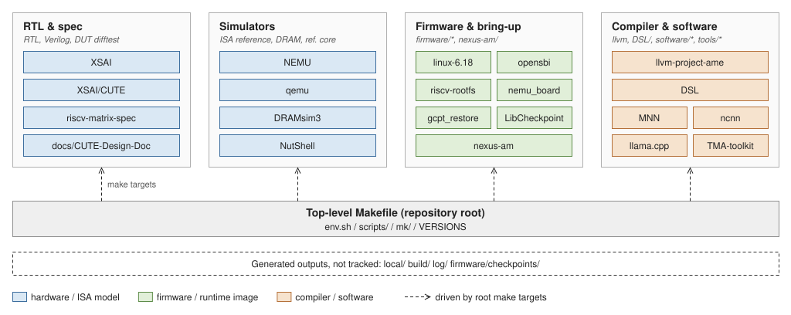

# SDK 组成与目录结构 {#sec:sdk-layout}

`xsai-env` 把 RTL、模拟器、固件、rootfs、工具链和验证流程放在同一个顶层 `Makefile` 之下。这一章说明各部分放在哪、各自负责什么，以及环境变量与工具链的要求。首次搭建步骤见[15 分钟上手](../start/quickstart.md#sec:get-started)，构建目标见[构建系统与 make 目标](build.md#sec:sdk-build)。

## 三条基本约定

* **仓库根是入口**。设置、构建、运行命令都从根目录发起，不要进各子模块里单独跑。
* **不是扁平仓库**。每个子系统保留自己的源码、工具链假设和验证路径，版本由子模块固定，见[子模块与版本管理](submodules.md#sec:sdk-submodules)。
* **生成产物不入库**。`local/`、`build/`、`log/`、`firmware/checkpoints/` 都是产物目录。

## 目录职责

| 目录 | 内容与职责 |
| --- | --- |
| `Makefile`、`scripts/`、`mk/`、`env.sh`、`.envrc*`、`docs/` | 顶层编排、共享环境、仓库约定、集成文档 |
| `XSAI/` | RTL 源码、生成的 Verilog、仿真器构建、DUT 侧差分验证；矩阵核在 `XSAI/CUTE/` |
| `NEMU/` | ISA 参考模型、差分验证的参考 `.so`、profiling 与 checkpoint 支持 |
| `qemu/` | Linux 与用户态仿真、QEMU machine 支持、checkpoint 流所用的 profiling plugin |
| `firmware/` | Linux、rootfs、OpenSBI、DTB、GCPT 启动负载与板级启动流程 |
| `nexus-am/` | 裸机运行时与库，NEMU 与 RTL 流程用的裸机程序与测试 |
| `llvm-project-ame/` | 支持 AME 的 LLVM/Clang、反汇编与底层代码生成 |
| `DSL/` | Triton、TileLang、TVM 等高层编译器前端 |
| `software/` | 推理框架与工作负载，见下节 |
| `firmware/riscv-rootfs/apps/`、`nexus-am/apps/` | Linux 侧应用与裸机应用，含 benchmark 与 demo |
| `DRAMsim3/` | DRAM 模拟器 |
| `NutShell/` | 部分验证流程使用的参考处理器 |
| `riscv-matrix-spec/` | 矩阵扩展规范 |
| `tests/`、`tools/` | 顶层协调点与开发者工具，含 TMA-toolkit、打包与报告脚本 |

`DSL/`、`software/`、`tests/`、`tools/` 是顶层命名空间，当前内容多少不代表它的重要程度——大量实际测试与工具仍在各组件仓库内。

## 推理框架

MNN、ncnn、llama.cpp 与 `tools/TMA-toolkit` 都是顶层子模块，版本由 gitlink 与 `VERSIONS` 固定：

| 组件 | 路径 | XSAI 适配位置 |
| --- | --- | --- |
| MNN | `software/MNN` | `source/backend/cpu/ame/`、`ame_xsa.c`、`Int8GemmKernelXSAI.cpp` |
| ncnn | `software/ncnn` | `src/layer/riscv/convolution_bf16_xsai.h`、`convolution_int8_xsai.h` |
| llama.cpp | `software/llama.cpp` | ggml 路径，见[算子库与推理框架](../software/frameworks.md#sec:sw-frameworks) |
| TMA-toolkit | `tools/TMA-toolkit` | 配合[性能监测](../hardware/pmu.md#sec:xsai-pmu)使用 |

`make software-init` 初始化这三个框架子模块与 `firmware/riscv-rootfs`；`make test-ai-software` 执行软件栈验证。

## 环境变量

`env.sh` 与 `.envrc.base` 都通过 `scripts/env-common.sh` 填充共享环境：

| 变量 | 含义 |
| --- | --- |
| `XS_PROJECT_ROOT` | 仓库根 |
| `NEMU_HOME` / `QEMU_HOME` | `./NEMU` / `./qemu` |
| `AM_HOME` / `NOOP_HOME` | `./nexus-am` / `./XSAI` |
| `LLVM_HOME` | 默认 `./local/llvm` |
| `RISCV_LINUX_HOME` / `RISCV_ROOTFS_HOME` | `./firmware/riscv-linux` / `./firmware/riscv-rootfs` |
| `RISCV` | 依次从显式环境变量、已知共享安装、`/opt/riscv`、`PATH` 解析；成功后 `$RISCV/bin` 会前置到 `PATH` |
| `RISCV_SYSROOT` / `QEMU_LD_PREFIX` | 前者由所选工具链解析；后者默认取检测到的 RISC-V sysroot |
| `CROSS_COMPILE` | **有意不在顶层导出**，由 firmware 与 software 流程各自设置 |

机器相关的覆盖项写在 `.envrc.local`（从 `.envrc.local.example` 复制，不入库）。direnv 的安装见 <https://direnv.net/docs/installation.html>。

`run-user` 场景需要显式设置 `QEMU_LD_PREFIX`，否则报 `Could not open '/lib/ld-linux-riscv64-lp64d.so.1'`。

初始化时子模块从本地缓存目录 `local/git-cache/submodules` 取，后续初始化与 git worktree 复用同一份对象，不再重复从远端克隆。跨 checkout 共享可设 `GIT_SUBMODULE_CACHE`；用现有 checkout 播种缺失缓存可设 `GIT_SUBMODULE_SOURCE_ROOTS`。

## 工具链要求

| 项 | 要求 |
| --- | --- |
| 交叉编译器 | `riscv64-unknown-linux-gnu-gcc` 在 `PATH` 上，`RISCV` 指向工具链根 |
| 固件自检 | `make -C firmware check-env`，检查编译器存在并打印版本 |
| 完整环境自检 | `make test`，需要支持 `-march=rv64gcbkvh` 的编译器，否则报 `No supported RISC-V compiler found!` |
| 系统依赖 | `make deps`（Ubuntu / Debian，需 sudo） |

QEMU 构建会在 `configure` 前清掉宿主侧的交叉编译变量，避免污染。

### AME LLVM 的获取

AME 矩阵指令需要带扩展支持的 LLVM/Clang。**优先用预编译包**，不必从源码构建：

| 项 | 说明 |
| --- | --- |
| 下载地址 | <https://github.com/OurCompArchGroup/llvm-release/tags> |
| 产物 | 每个 tag 附一个 `llvm-<日期>[-proposal-N].tar.gz`，约 1.2 GB，解包即用 |
| 当前可用 tag | `20260708`（`llvm-20260708-proposal-14.tar.gz`）、`20260528`（`llvm-20260528.tar.gz`） |
| 从源码构建 | `make llvm`，输出到 `local/llvm`；源码在 `llvm-project-ame/` |

`make llvm` 会先探测宿主侧的 RISC-V 交叉编译器（优先级：`RISCV` → `RISCV_TOOLCHAIN_PREFIX` → `riscv64-linux-gnu-`），缺失时报错并提示安装 `gcc-riscv64-linux-gnu`。
