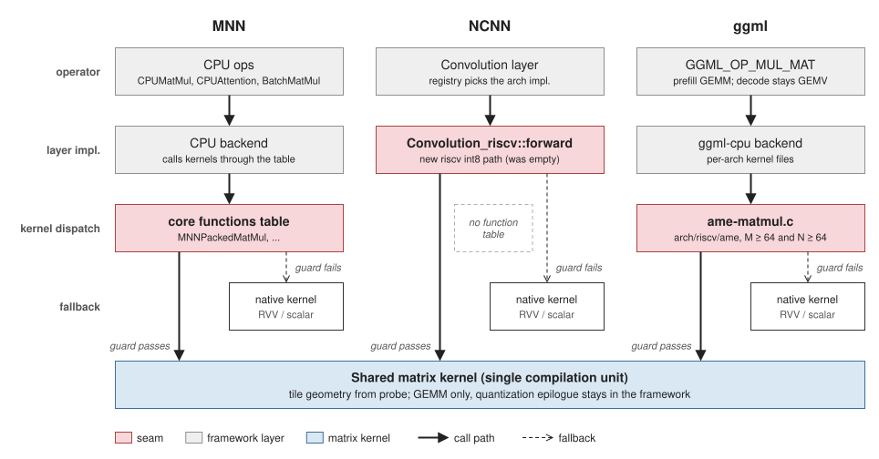

# 算子库与推理框架 {#sec:sw-frameworks}

这一章讲怎么把矩阵单元接进推理框架与算子库：算子库的分层、三个框架各自的替换点、必须守住的硬件约束，以及怎么验证结果。

## 算子库（xsai-blas）

### 分层结构

```text
API → Interface → Kernel（generic / rvv / ame / triton）→ Platform
```

* 统一 `validate` / `execute` 接口；
* 覆盖 gemm、gemv、matmul、softmax、silu、rms_norm、add、div、mul 等算子；
* 调用描述符（`xsai_op_call_t`）+ op_handler 表 + dispatcher 的结构，新增算子只需实现一个 handler；
* 张量接口与 DLPack 对齐，框架侧张量可以零拷贝传入。

这样做的价值是把硬件专有操作封装为稳定计算接口，降低上层框架对指令与 SoC 细节的依赖。

### 算子清单

| 分类 | 算子 | 说明 |
| --- | --- | --- |
| 矩阵乘 | gemm、gemv、matmul | 走矩阵单元的 GEMM 路径，需先通过[启用条件](#sec:sw-fw-guards) |
| 归一化 | softmax、rms_norm、layernorm | 矩阵单元上的典型实现 |
| 激活 | silu、gelu | 常与 GEMM 融合进 epilogue |
| 逐元素 | add、div、mul | 多数留在向量 / 标量路径 |

### 新增算子的写法

新增算子只需实现一个 handler 并注册到 op_handler 表：

```c
/* 调用描述符携带算子的类型、形状与指针 */
xsai_op_call_t call = {
    .op      = XSAI_OP_GEMM,
    .dtype   = XSAI_DTYPE_INT8,
    .m = m, .n = n, .k = k,
    .a = a, .b = b, .c = c,
};

/* handler 内部完成条件判断与 kernel 选择 */
int rc = xsai_gemm_handler(&call);
if (rc != 0) {
    /* 条件不满足时返回非 0，由上层退回框架原实现 */
}
```

**handler 的职责边界**：判断条件、选择 kernel 实现、必要时退回框架原实现；不做量化格式转换（那属于框架 epilogue）。

## 接入矩阵单元的通用方法

接入矩阵单元按以下五步推进，顺序不可调换。

1. **先读硬件尺寸**：用 CSR 探针读出原生 tile 尺寸（native 为 M128 × N128 × K64），按读到的值生成核。写死尺寸的话，换一套硬件就会算错，而且不会报错。详见[数据寄存器](../isa/registers.md#sec:xsai-registers)。
2. **找框架里的原生替换点**：优先"换实现即换核"的函数表；其次 arch 层 layer 实现；最后才是调用点 drop-in。
3. **单一编译单元**：所有矩阵指令集中在同一个编译单元里，其他文件只经头文件调用。
4. **加条件判断与退回路径**：能力、形状、工作量都要检查，任一不满足就让上层走框架原实现，绝不返回错数据。
5. **差分验证，再逐级验证到上板**：先要求输出完全相同，QEMU 只验算术，板级结论为准。

### 硬约束

| 约束 | 内容 |
| --- | --- |
| tile 尺寸 | 原生为 M128 × N128 × K64（设计文档按 M-K-N 写作 `128x64x128`），实际值从探针取，不要写死 |
| bf16 的 K 参数 | `msettilek` 按**元素**计（bf16 为 32、i8 为 64），而 tile 的**行宽** `TRLEN` 是 **64 字节**。注意 `mla` / `mlb` 的汇编形态是 `mla tr0, (base), stride`，**没有长度操作数**，`stride` 单位为字节 |
| 累加器 C | **随输入类型而定**：整数路径 i8 × i8 → **int32**，浮点路径（bf16 / fp16 / tf32）→ **fp32**；低精度输入不改变累加器宽度 |
| 操作数池 | 必须物理连续；池基址由运行期解析（环境变量 → 设备树 `direct_map` → 编译期默认值），不是固定值；默认布局为 6 GiB @ `0x1_0000_0000`，mega 布局为 4 GiB @ `0x3_8000_0000`，详见[内存子系统与 HBL2](../hardware/memory.md#sec:xsai-memory)。AMU 行寻址不查 TLB，非连续内存静默读错 |
| 基址寄存器 | MSC 基址钉 `s11`，保活到 `macquire`；每张 tile 用 `msyncregreset` |
| 同步 | `macquire` 管矩阵结果对外的可见性，`mfence` 管非矩阵访存对矩阵引擎的可见性；`mrelease` / `macquire` 必须覆盖所有退出分支 |

### 启用条件 {#sec:sw-fw-guards}

| 条件 | 判断依据 | 不满足时 |
| --- | --- | --- |
| 尺寸可用 | 探针读出的尺寸可信 | 整条矩阵路径关闭 |
| 形状 | K ≤ 上限（默认 8192 元素）、`real_count` 在合法范围 | 退回框架原实现 |
| 工作量 | `oc × K ≥ 16384`（可用环境变量调整） | 退回框架原实现 |

为什么要有工作量这条：卷积每次只给 8 个像素，`tile_m = 128` 时 M 利用率恒定 6%，只有 `oc × K` 够大才值得占用一张几乎空的 tile。小规模的层交给框架自带的 RVV 核更快。

## 框架替换点对照



| 框架 | 替换点 | 说明 |
| --- | --- | --- |
| MNN | core functions 函数表（`MNNPackedMatMul` 等） | "换表即换核"，覆盖面最广；LLM 的 `CPUMatMul`、`CPUAttention`、`BatchMatMul` 全走同一张表 |
| NCNN | arch 层 layer 实现（registry + `Convolution_riscv::forward`） | 无函数表，不要在调用点做 drop-in（各变体要分别插入且需自己做 pack）；riscv int8 卷积原本空缺，直接新写即可 |
| ggml | `ggml-cpu/arch/riscv/ame/ame-matmul.c` | 参照实现；选核要求 `M ≥ 64` 且 `N ≥ 64`，即 decode（M=1）不吃 tile、prefill 才受益 |

### 矩阵开关（AME on/off）

「开关开、关下输出完全相同」是本章及后续章节反复使用的首要依据，但**三个框架的开关机制各不相同**，没有统一开关：

| 框架 | 开关 | 机制 |
| --- | --- | --- |
| MNN | 环境变量 `XSAI_MNN_AME`，值须为 `1` | 运行期判定；bf16、LLM 与 int8 路径都读它 |
| NCNN | 编译期宏 `NCNN_XSAI_AME` **加** 运行期环境变量 `XSAI_NCNN_AME`（int8）/ `XSAI_NCNN_AME_BF16`（bf16） | **两者都要**：宏 gate 掉代码路径，环境变量在运行期选择；环境变量值必须**恰好为 `1`** |
| ggml | buffer type `--buft RISCV_AME` | 运行期后端选择，**不是环境变量** |

ggml 另有一组细粒度环境变量（`GGML_AME_*`，如 `GGML_AME_PACKED_Q8`、`GGML_AME_FLASH_ATTN`），用于逐项关闭单个优化；做差分时保持它们不变。

**判定"是否真的走了矩阵路径"不能只看框架日志里的后端名。** ggml 场景下 AME 是 ggml CPU backend 下的 `RISCV_AME` 路径，`be` 列显示 `CPU` 并不代表没用 AME——应查 `[AME_PROFILE]`、`[GGML_XSAI_OP_PROFILE]` 与 AME dispatch 日志。

## llama.cpp / GGML

* 通过矩阵后端接入，模型侧可细分为算子 diff 测试与逐层采样；
* 选核要求 `M ≥ 64 且 N ≥ 64`：decode 走 vec-dot/GEMV，prefill 才用矩阵单元；
* K 维对齐：K 不是 128 整数倍时需要 padding 或尾数处理（相关算子曾因此产生偏差）。

### 算子性能的分析方法

要判断瓶颈在硬件还是软件，把矩阵单元的周期按**阶段**分解，而不是只看总利用率。第一步是分清两个统计范围：

| 统计范围 | 公式 | 含义 |
| --- | --- | --- |
| 整算子 | `logical ops / AME total cycles / 峰值 logical ops per cycle` | 端到端，含全部软件阶段 |
| 宏调用路径 | `logical ops / ame_tile_call cycles / 峰值` | 仅矩阵单元被调用的那一段 |

**两者必须分开看。** 整算子利用率低不等于硬件不行——差距可能几乎全部来自软件侧阶段：量化、数据 pack、scale epilogue、边缘 tile、等待数据送达的时间。把周期按阶段拆开后，真正驱动矩阵单元的 `ame_tile_call` 与其余阶段的占比会直接告诉你该优化软件还是硬件，以及优化收益的上限在哪。

阶段名、可用计数器与逐层分解见[性能监测](../hardware/pmu.md#sec:xsai-pmu)。

跨 K64 做 INT32 累加时需做溢出证明：`K × 127 × 127 ≤ INT32_MAX`，K=8192 时为 132,128,768，满足范围；更大的 K 必须重新证明。该做法会改变权重与激活的量化粒度与累加顺序，必须补真实模型精度回归。

## 端侧框架

* **MNN**：int8 pack 约定 `UNIT=4(oc)` / `SRC_UNIT=16(ic)` / `DST_XUNIT=8(px)`；bf16 层保持 `bytes=4`、仅 matmul 操作数 `matmulBytes=2`；`CPUMatMul` 的 `[l][eP]` 布局（转置 + 原地 lowp）与 bf16 核期望布局一致，不要额外加转换层；LLM 在 riscv 上默认走 fp32，需要显式设 `Precision_Low_BF16`。
* **NCNN**：交叉编译必须关掉宿主 ISA 选项（`NCNN_SSE2` / `AVX` / `AVX2` / `AVXVNNI` / `AVX512` / `XOP` / `FMA=OFF`）并使用 toolchain file；测试**成功时静默**（`rc=0` 无输出），判定靠返回码加调用计数；`onnx2ncnn` 对动态 shape 处理不正确（bin 头写 NaN、生成未注册的 Shape 层），需先在 ONNX 层把 `Shape→Gather→Unsqueeze→Concat→Reshape` 折叠为常量，折叠后用 ONNX Runtime 验证 argmax 不变再转换。
* **fp16 权重模型**：转到 bf16 后端即可（ggml `F16_BF16` 思路），不必为 fp16 单独写核。

## 量化格式的处理原则

矩阵核只做 GEMM（int8 → int32 精确累加）；scale 表、zero-point 补偿、requant/dequant、clamp、融合激活一律与框架参考实现的 epilogue 保持一致。这样输出能与框架参考实现逐字节相同，格式差异因此被覆盖。替换点定在 GEMM 层，不要把量化格式搬到核里重新实现。

| 维度 | 变体 | 处理方式 |
| --- | --- | --- |
| scale 粒度 | per-tensor / per-output-channel | per-oc 最常见；按 oc 取尾表，读取路径与 per-tensor 完全一致 |
| 输入 zero-point | symmetric / asymmetric | MNN 用 `srcSum × weightBias` 补偿：先求 A 的行和，再在 epilogue 加该修正项 |
| 输出类型 | requant→int8 / dequant→fp32 | 两条 epilogue 分支都要实现（NCNN 以 `int8_scale_term > 100` 判定 requant；除零要判） |
| 饱和 / 钳位 | int8 `[-127,127]` / fp32 `fp32minmax` | 与参考实现一致 |
| 融合激活 | 有 | 沿用框架的 activation 参数，不要自行近似 |

**不支持的格式直接退回框架原实现，不做近似**：权重不是每元素 1 字节（4-bit / 6-bit / 混合精度压缩权重）、packed 布局（`elempack > 1` 需先 unpack 或让 A 的打包感知 pack）、形状超限、工作量不足。

bf16 与 fp16 属于精度而非量化格式：bf16 是 fp32 取高 16 位、fp32 累加、C 按框架契约写 fp32 或截断到 bf16 网格。bf16 与 int8 的开关必须分开，因为 bf16 会改变浮点精度，共用一个开关会让官方 fp32 测试因容差挂掉。

## 验证方法

```plain
框架自带测试（算子级）→ QEMU 用户态（网络级，仅算术结论）→ NEMU → 板级实测（权威）
```

* **优先使用框架自带测试，不要另造一套**：MNN 用 `run_test.out <test> 0 <precision>`（3 为 `Low_BF16`）；NCNN 每个算子一个可执行文件，`rc=0` 即通过；ggml 用 `test-backend-ops`、`test-op`。
* 可信度排序：① 同一模型在矩阵开关开、关两种模式下输出**逐字节相同**（这一条最直接，与精度无关）；② 框架自带测试在两种模式下都通过，且失败只出现在开关打开时；③ 自造参考实现双模式逐元素比对（int8 要求完全相同，bf16 用两级容差）；④ 与外部真值（ONNX Runtime 或 host 框架）比 argmax 或 top-5。
* 量化校准方法与矩阵适配无关：int8 校准用百分位还是 KL 会改变 argmax，误差来自校准方法本身；适配是否正确，只看开关开、关下输出是否逐字节相同。
* 自造差分工具只在框架测试覆盖不到时补位（某个形状、尾块、深 K 组合），或需要逐元素位级比对时使用。
