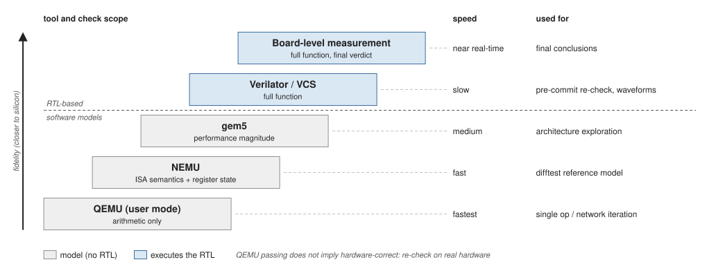

# 功能模拟器 {#sec:sw-simulators}

功能模拟器用于在没有 RTL 的情况下跑通软件、做算子级与网络级的差分验证。

## NEMU

* 矩阵扩展已合入上游，支持矩阵指令与矩阵寄存器状态；
* 作为差分验证的参考模型时，对矩阵寄存器做哈希比对（见[差分验证](../verification/difftest.md#sec:debug-difftest)）；
* 自带的性能统计方式：启用 AVX-512 后相对解释执行有明显加速，具体倍率随宿主与负载而变，以本机实测为准。

## QEMU

* 用户态（`qemu-riscv64`）：跑算子级与框架自带的单算子测试，迭代最快；
* 系统态：跑完整启动流程与 Linux 用户程序；
* 多人在同一份 QEMU 分支（`.gitmodules` 记录的 `9.0.0_matrix-v0.12`）上持续打补丁，合并前注意同步。

矩阵路径下 QEMU 结论的适用范围：QEMU 模拟的是算术语义，不覆盖硬件的尺寸与布局约束（tile 尺寸、物理连续池、行寻址），因此 QEMU 全对不能推出板上正确。QEMU 结论必须标注"仅算术结论"，并以板上复验为准。

## gem5

* 用于设计探索与性能评估；具体偏差需以对应 workload 的对比报告为准；
* 适合做架构参数扫描，不适合作为功能正确性的判定依据。

## 与 RTL 仿真的分工

| 工具 | 速度 | 能判断什么 | 适用场景 |
| --- | --- | --- | --- |
| QEMU（用户态） | 最快 | 仅算术 | 单算子、网络级快速迭代 |
| NEMU | 快 | 指令语义 + 寄存器状态 | 差分验证参考模型 |
| gem5 | 中 | 性能量级 | 架构参数探索 |
| Verilator / VCS | 慢 | 完整功能 | 提交前复验、波形定位 |

## 后端选择

### 后端与配置的匹配

| 条件 | 选择 | 原因 |
| --- | --- | --- |
| ZhuJiang LLC | **Verilator** | 当前 GSIM 不支持 ZhuJiang 所需的有状态 `GENERIC_RAM_*` 与 `ResetGenInnerS2` 外部模块 |
| OpenLLC | GSIM 或 Verilator | 两者均可 |

**不能用无状态桩替代缺失模块后再做正确性或性能结论。**

### 性能优化建议

* **PGO 值得开启**：Verilator 与 GSIM 都支持 `-O3 -fprofile-use`。PGO 不能替代 `-O3`，是在其之上的额外收益；用同负载训练效果最好，换负载后需重新训练；
* **Verilator 线程数按配置实测**：线程数并非越多越好。当线程数超过物理性能核数时，较慢的 worker 会拉长每步同步与 barrier 等待，反而变慢。**最优值随配置而变，不要从一个配置外推到另一个**，建议在实际使用的配置上把 2 / 4 / 6 / 8 各测一次；
* **构建资源**：Verilator 与 GSIM 的构建时间与内存占用都较高，且 GSIM 的峰值内存明显高于 Verilator，选后端时需一并考虑构建机器与缓存。

### 仿真频率的算法

仿真频率按 `guest cycles / host time` 计算。不同配置的启动与结束路径会造成总周期不同，因此**跨配置比较以频率为主，不直接比总耗时**。每次模拟建议串行运行，避免相互干扰。

## 版本对应

| 组件 | 版本 / 说明 |
| --- | --- |
| NEMU | 子模块固定在 `v2026.07.r12`（见[子模块与版本管理](../sdk/submodules.md#sec:sdk-submodules)） |
| QEMU | 分支 `9.0.0_matrix-v0.12` |
| GSIM | 实测版本 `50b371c`；尚不支持 ZhuJiang 所需的有状态外部模块 |
| Verilator / VCS | 见[Verilator 仿真](../verification/verilator.md#sec:sim-verilator)与[VCS 仿真与用例框架](../verification/vcs.md#sec:sim-vcs) |
