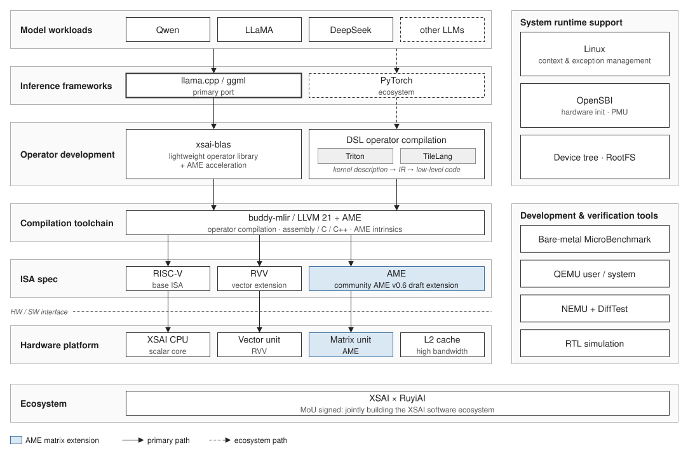
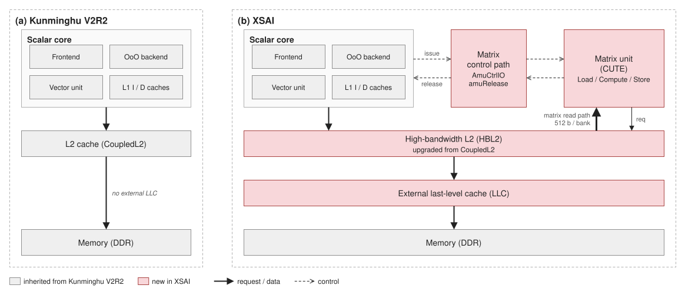

# 香炉峰 AI 软硬件总览 {#sec:xsai-overview}

香炉峰（XSAI）是在香山昆明湖 V2R2 基础上扩展的、面向 AI 推理的 RISC-V 处理器。它保留 CPU 编程模型，增加 AME 矩阵计算扩展、矩阵控制通路与高带宽 L2（HBL2）。

本手册只描述相对昆明湖 V2R2 的增量；与基线相同的部分请参见《香山开源处理器用户手册》。逐项差异见[附录 A](../appendix/diff.md#sec:appendix-diff)。

## 与昆明湖 V2R2 的关系

* 基线：香山昆明湖 V2R2
* 增量主线：AME 矩阵计算扩展、矩阵控制通路、高带宽 L2（HBL2）、异步矩阵执行
* 软件可见变化：新增指令与 CSR、设备树能力描述、矩阵访存对齐与转置约束、异步同步语义
* 调试可见变化：矩阵寄存器的差分对比支持、矩阵相关性能计数器、checkpoint 采样机制

## 软硬件分层

香炉峰的能力要经过编译器、算子库和推理框架才能到达模型。下图为全栈分层，表格把每一层对应到本手册的章节。

| 层 | 内容 | 详见 |
| --- | --- | --- |
| 模型与应用 | 端侧大模型、视觉模型、语音模型 | — |
| 推理框架 | llama.cpp / ggml、MNN、NCNN | [算子库与推理框架](../software/frameworks.md#sec:sw-frameworks) |
| 算子库 | GEMM、attention、量化与反量化核 | [算子库与推理框架](../software/frameworks.md#sec:sw-frameworks) |
| 编译器与运行时 | LLVM 后端、算子 DSL、系统软件 | [编译器与算子 DSL](../software/compiler.md#sec:sw-compiler)、[系统软件与运行时](../software/system.md#sec:sw-system) |
| 香炉峰处理器 | 标量核 + 矩阵计算单元 + 高带宽二级缓存 | [微架构增量](../hardware/microarchitecture.md#sec:xsai-microarchitecture) |
| 存储与内存 | HBL2、DDR 主存 | [内存子系统与 HBL2](../hardware/memory.md#sec:xsai-memory) |

## 相对昆明湖 V2R2 的硬件增量

昆明湖 V2R2 提供标量核、乱序流水、缓存层次与向量单元；香炉峰在其上增加矩阵计算单元（CUTE）、矩阵控制通路与高带宽二级缓存。

## 生态合作

香炉峰与 RuyiAI 合作建设软件生态，范围覆盖三处：框架侧接入 llama.cpp / ggml、MNN、NCNN 的矩阵后端；算子侧共同维护 xsai-blas 的算子实现；编译侧沿 LLVM 后端打通 Triton、TileLang 的算子描述到矩阵指令的路径。

共建内容分别在[算子库与推理框架](../software/frameworks.md#sec:sw-frameworks)与[编译器与算子 DSL](../software/compiler.md#sec:sw-compiler)两章展开。上层框架的行为如果与本手册描述的指令或内存约束不一致，以本手册为准。
